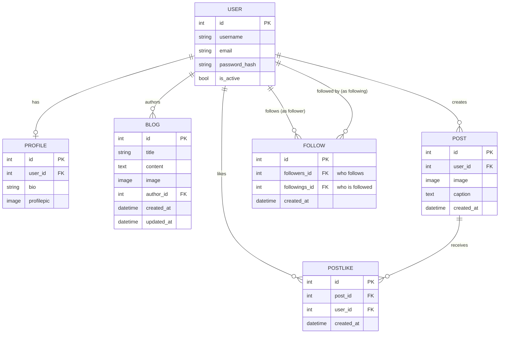
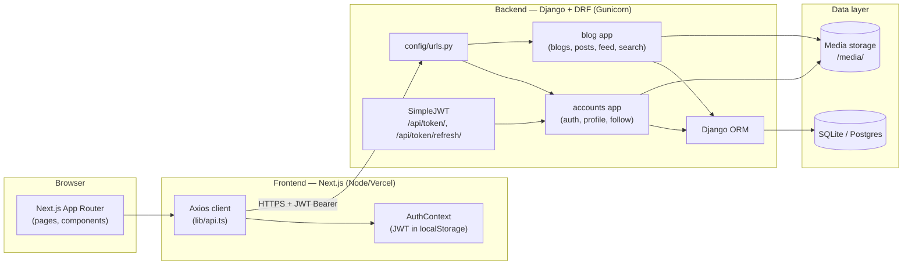
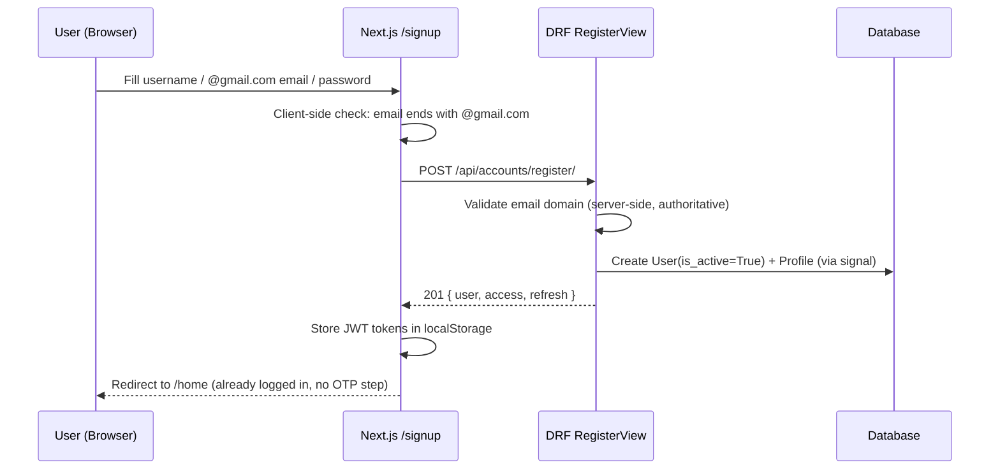
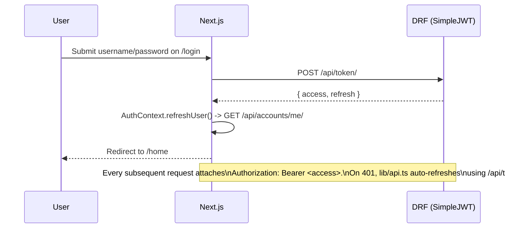
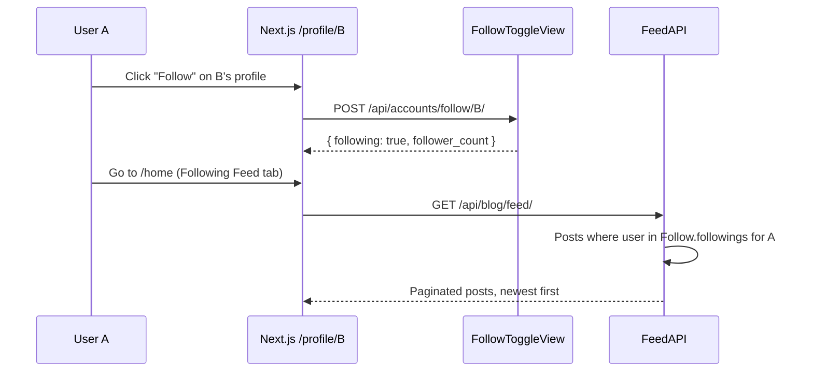
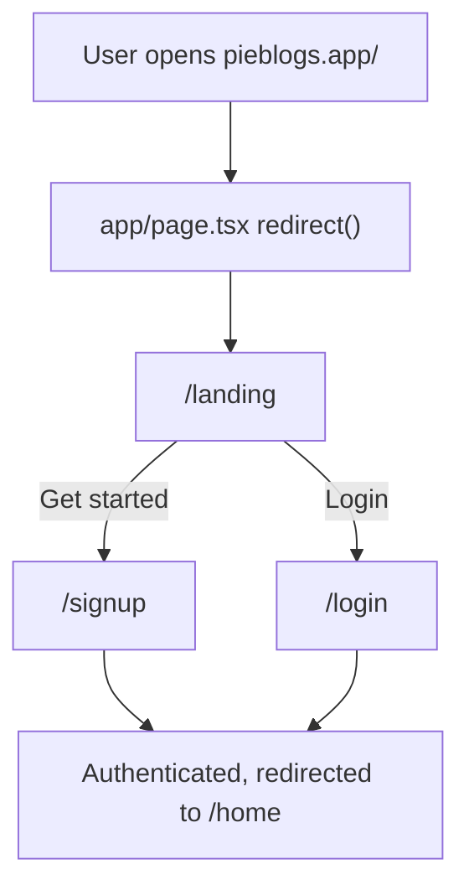

# PieBlogs V1 — ER Diagram & Architecture

## 1. Entity-Relationship Diagram

Notes:
- `USER` is Django's built-in `auth.User`.
- `PROFILE` is a strict 1-1 extension (auto-created via a `post_save` signal).
- `FOLLOW` is a self-referencing many-to-many on `USER`, modelled explicitly so
  follower/following counts and lists are cheap queries. A unique constraint
  on `(followers, followings)` prevents duplicate follow edges.
- `POSTLIKE` is the join table for the like feature, unique per `(post, user)`.
- The old `EmailOTP` entity from V0 is **removed** — there is no
  verification-pending state anymore; a `USER` row is created `is_active=True`
  directly.

## 2. System Architecture

## 3. Key Workflows

### 3.1 Sign-up (no email verification)

### 3.2 Login → protected route

### 3.3 Follow → personalized feed

### 3.4 First-time visit → landing page

## 4. Removed vs. Added in V1

| Area | V0 (Django templates) | V1 (this rebuild) |
|---|---|---|
| Frontend | Django server-rendered templates | Next.js (App Router) SPA-style client |
| Email verification | OTP sent by email, `EmailOTP` model, `verify-otp` step | **Removed.** Sign-up restricted to `@gmail.com`, account active immediately |
| Auth transport | Django session auth (mixed with partial JWT) | DRF + SimpleJWT (Bearer tokens) end-to-end |
| API layer | Mix of function/class views + partial DRF | 100% DRF (ViewSets, generics, routers) |
| Secret key | Old key from repo `.env` | Freshly generated, rotated key (see backend `.env.example`) |
| Entry point | `/` served `HomeView` template directly | `/landing` marketing page is the first stop; `/` redirects there |
| Likes | Not present | `PostLike` model + `/like/` action added |
